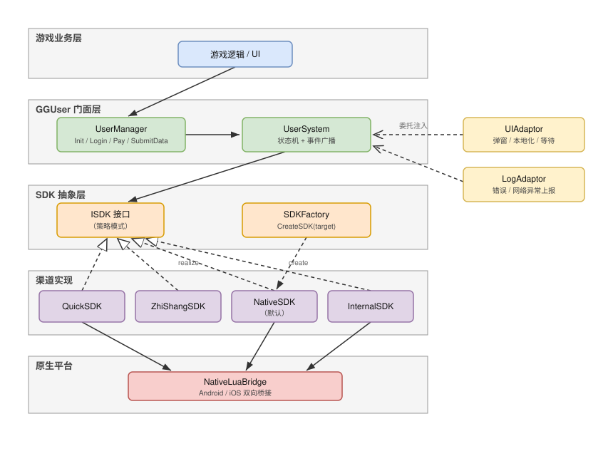

  <h1 align="center">GGUser (内测版)</h1>
  

    
    
    
    
  

  
一个游戏客户端的用户 / 登录 / 支付 SDK 管理框架

## 简介

GGUser 是一个面向游戏客户端的**用户系统与 SDK 接入管理框架**，用于统一对接各个渠道的账号登录、支付、数据上报等能力。它通过抽象 SDK 接口 + 工厂 + 事件回调，将具体渠道实现与游戏业务解耦，支持方便地切换和接入多个渠道 SDK。

### 架构示意

> 图表以 **draw.io** 维护，源文件见 [`documents/diagrams/architecture.drawio`](documents/diagrams/architecture.drawio)。
> 登录 / 支付时序图与状态机图见 **[技术设计文档](documents/technical-design.md)**。

> **依赖倒置**：`UIAdaptor` / `LogAdaptor` 通过委托将界面、上报能力交给宿主注入，GGUser 本身不绑定任何具体 UI / 网络框架。

## 功能与特性

**用户与 SDK 管理**

- **用户系统**（`UserSystem`）：驱动 SDK 初始化、登录、支付全流程，以内置状态机管理各阶段（初始化 / 登录成功等）
- **业务门面**（`UserManager`）：在用户系统之上提供 `Init` / `Login` / `Pay` / `SubmitData` / `HasLogined` 等高层 API

**多渠道 SDK 接入（策略模式）**

- `ISDK` 抽象接口 + `SDKFactory` 工厂，按 `SDKTarget` 创建对应渠道实现（当前工厂可直接创建 **NativeSDK**（默认）与 **智尚 SDK**）
- 其余实现：**QuickSDK** 需启用 `QUICK_SDK` 宏并在工厂对应分支放开；**InternalSDK** 未纳入 `SDKTarget` 枚举，需手动实例化
- 编辑器内通过 `SIMULATION_MODE_SDK` 宏启用模拟 SDK，无需真机能跑通登录 / 支付流程

**与原生平台桥接**

- `NativeLuaBridge`：Unity（含 Lua）与 Android / iOS 原生代码的双向桥接
  - Android：`AndroidJavaClass` 静态调用原生 SDK 方法
  - iOS：`[DllImport("__Internal")]` 声明原生 C 接口
- 平台接口：设备 UID 获取封装（`GetDeviceUID`，iOS 分支为 TODO）；`GetDeviceID` 目前为预留空实现

**可插拔解耦**

- `UIAdaptor`：通过委托注入弹窗 / 本地化 / 等待等 UI 能力，不绑定具体 UI 框架
- `LogAdaptor`：通过委托注入错误 / 网络异常上报
- 事件驱动：以 `Events` 枚举 + 回调对外广播登录、支付等生命周期事件

**数据模型**

- `Order` / `UserData` 数据模型自带 JSON 序列化（`GetJsonString`），便于打包上报与回调解析

## 工程内容

<table>
    <tr><th>目录</th><th>内容</th><th>说明</th></tr>
    <tr>
        <td>GGUser/Assets/Scripts/GGUser</td>
        <td>框架代码</td>
        <td>可以直接复制到目标工程中使用（需另加 GGFramework.Core UPM 依赖，见「依赖」）。</td>
    </tr>
    <tr>
        <td>GGUser/Assets/Demo</td>
        <td>演示工程</td>
        <td>打开 <code>Demo.unity</code> 直接运行：uGUI 面板演示聚合平台初始化 / 登录 / 支付 / 补单全链路。</td>
    </tr>
    <tr>
        <td>GGUser/Assets/Tests</td>
        <td>单元测试</td>
        <td>基于 Unity Test Framework 的 EditMode / PlayMode 用例（详见下方「测试」）。</td>
    </tr>
</table>

## 核心模块

| 模块 | 说明 |
| ---- | ---- |
| `Systems/UserSystem` | 核心用户系统（单例）：SDK 初始化 / 登录 / 支付流程与事件广播 |
| `User/UserManager` | 高层业务门面（单例）：认证 / 登录 / 支付 / 数据上报 API |
| `User/ISDK`、`User/SDKFactory` | SDK 抽象接口与工厂（策略模式） |
| `User/QuickSDK`、`ZhiShangSDK`、`NativeSDK`、`InternalSDK` | 各渠道 SDK 实现 |
| `Platform/NativeLuaBridge`、`PlatformInterfaces`、`AndroidInterfaces` | 原生平台桥接 |
| `Platform/GGPlatform` | 聚合平台门面（MVP）：渠道路由 / 支付全链路 / 登录换 token / 掉单补单 |
| `Channels`、`Models`、`Config` | 聚合平台能力抽象（`ILoginChannel`/`IPayChannel`）、归一化模型、配置驱动（详见[聚合平台设计文档](/documents/aggregation-platform-design.md)） |

## 依赖

* **GGFramework.Core** — `Singleton` / `CoroutineUtil` 等基础类的单一源，经 UPM git URL 引用（`#v0.1.1`）；工程内原本地 `Singleton.cs` / `CoroutineUtil.cs` 副本已删除
* **MonsterLove/StateMachine** — Unity 轻量状态机库（位于 `Assets/LocalPackages`）
* **SimpleJson** — 轻量 JSON 序列化库（位于 `Assets/LocalPackages`）
* **Unity Test Framework** — `com.unity.test-framework`（单元测试，见下方「测试」）

## 测试

基于 **Unity Test Framework**，用例位于 `GGUser/Assets/Tests/`：

| 类型 | 目录 | 覆盖 |
| ---- | ---- | ---- |
| EditMode | `Tests/EditMode/` | 聚合平台 MVP（纯 C#）：`PlatformConfig` 解析/商品映射、`PayModels` 序列化、`ChannelRegistry` 懒创建与能力探测、`ChannelRouter` 平台硬约束/优先级/去重/回退候选、`GGGatewayClient` 校验与换 token、`SimulationChannel`、`GGPlatform` 支付全链路/fallback/校验未过不结束事务/补单 |
| PlayMode | `Tests/PlayMode/` | 遗留链路：`UserSystem` SDK 回调 → 状态机 → 事件广播、支付事件；`UserManager` 事件订阅、支付委托、登录成功推进 |

**运行**：Unity 菜单 `Window → General → Test Runner`，在 **EditMode** / **PlayMode** 页签运行全部用例。

> 为支持测试程序集引用，工程引入了 Assembly Definition：`SimpleJson`、`MonsterLove.StateMachine`、`GGFramework.GGUser`（`Assets/Scripts`，已引用 `GGFramework.Core.Runtime`），以及测试程序集 `GGFramework.GGUser.Tests.EditMode` / `.PlayMode`（`defineConstraints: UNITY_INCLUDE_TESTS`，不进入正式构建；同样引用 `GGFramework.Core.Runtime`）。`Demo` 仍在预定义的 `Assembly-CSharp`，自动引用上述程序集。

## 设计模式

* **策略模式** — `ISDK` 接口 + 多实现，按渠道切换
* **简单工厂** — `SDKFactory.CreateSDK(target)`
* **单例** — `UserManager` / `UserSystem` / `NativeLuaBridge`（`Singleton<T>` 由 `GGFramework.Core` 提供）
* **状态机** — 内置 `StateMachine<States>` 驱动登录 / 支付流程
* **适配器 / 依赖倒置** — `UIAdaptor` / `LogAdaptor` 委托注入
* **桥接** — `NativeLuaBridge` 实现 Unity ↔ 原生双向通信

## 文档

* [如何快速接入?](/documents/quickstart.md)
* [技术手册](/documents/manual.md)
* [技术设计文档](/documents/technical-design.md)（架构 / 登录 / 支付 / 状态机图）
* [聚合平台设计文档](/documents/aggregation-platform-design.md)（自建聚合层：AppStore / GooglePlay / 自定义渠道统一接入）

### 架构图表（draw.io）

| 图表 | 预览（SVG） | 可编辑源（drawio） |
| ---- | ---- | ---- |
| 架构分层 | [architecture.svg](/documents/diagrams/architecture.svg) | [architecture.drawio](/documents/diagrams/architecture.drawio) |
| 登录时序 | [login-sequence.svg](/documents/diagrams/login-sequence.svg) | [login-sequence.drawio](/documents/diagrams/login-sequence.drawio) |
| 支付时序 | [pay-sequence.svg](/documents/diagrams/pay-sequence.svg) | [pay-sequence.drawio](/documents/diagrams/pay-sequence.drawio) |
| 状态机 | [state-machine.svg](/documents/diagrams/state-machine.svg) | [state-machine.drawio](/documents/diagrams/state-machine.drawio) |
| 聚合平台架构 | [aggregation-architecture.svg](/documents/diagrams/aggregation-architecture.svg) | [aggregation-architecture.drawio](/documents/diagrams/aggregation-architecture.drawio) |
| 聚合支付时序 | [aggregation-pay-sequence.svg](/documents/diagrams/aggregation-pay-sequence.svg) | [aggregation-pay-sequence.drawio](/documents/diagrams/aggregation-pay-sequence.drawio) |
| 渠道路由 | [channel-routing.svg](/documents/diagrams/channel-routing.svg) | [channel-routing.drawio](/documents/diagrams/channel-routing.drawio) |

## 进群沟通

| | | |
| --- | -------- | -------- |
| QQ群: | 242500383 |  |

## TODO-List

* 完善 Login 环节的「游戏服认证 / 登录」对接（当前为预留位，可与 GGNetwork 组合）。未接入游戏服时，`Login` 会直接推进到已登录并触发回调，此时回调参数 `loginResponse` 为 `null`
* 一键对接说明 / 更多 Demo 场景（当前 `Demo.unity` 已以 uGUI 演示聚合平台全链路）
* 聚合平台（MVP 已落地客户端骨架）：待补真实渠道适配器（`AppleStoreChannel` / `GooglePlayChannel` / `CustomChannel` / `Legacy`）、自建服务端网关本体，以及与 `UserManager` 游戏服认证 TODO 的对接

## 更多资料

* [游戏开发图谱](https://github.com/gonglei007/GameDevMind)
