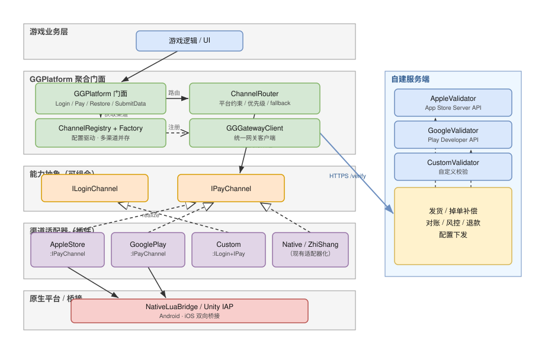
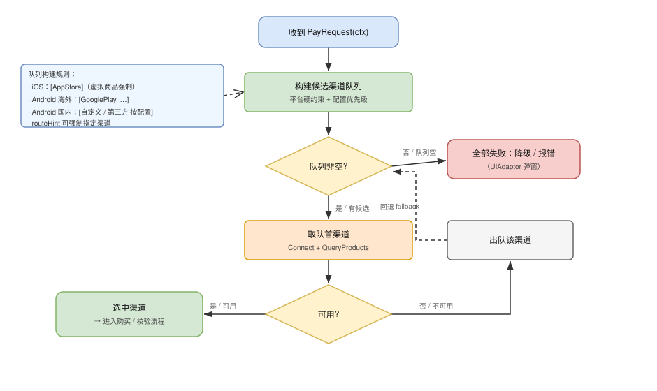
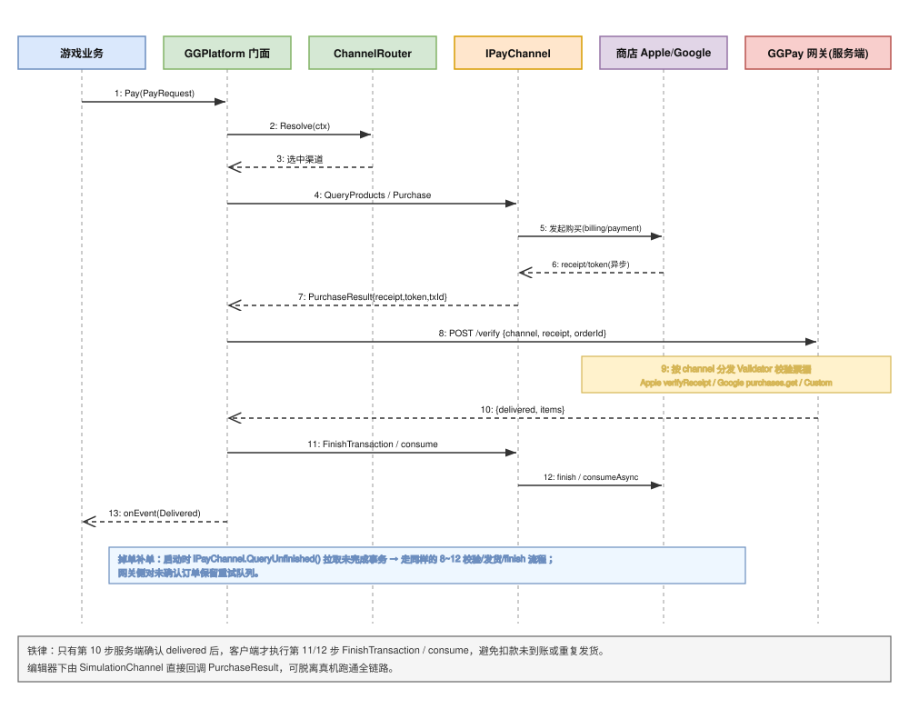

# GGUser 聚合平台设计文档

> 目标：让 GGUser 从「对接第三方聚合 SDK 的客户端框架」升级为**框架自身的聚合平台**——由 GGUser 统一掌握渠道调度、账号体系与支付网关，底下同时挂载 **AppStore**、**GooglePlay** 与**自定义/第三方**渠道实现。
>
> 命名空间 `GGFramework.GGUser`，Unity 版本 **2021.3.4f1c1**。本文既是设计蓝图，也已同步落地客户端 MVP 骨架（能力接口 / 归一化模型 / 注册中心 / 路由 / 网关客户端 / 模拟渠道 / 门面），详见 [第 14 节「已落地（MVP）」](#14-落地路线图)。配套 draw.io 图表位于 [`documents/diagrams/`](./diagrams/)。
>
> 阅读本文前建议先看 [technical-design.md](./technical-design.md) 了解现有架构。

---

## 目录

- [1. 背景与定位](#1-背景与定位)
- [2. 设计目标与原则](#2-设计目标与原则)
- [3. 总体架构](#3-总体架构)
- [4. 能力抽象：按能力而非渠道拆分](#4-能力抽象按能力而非渠道拆分)
- [5. 渠道注册中心与配置驱动](#5-渠道注册中心与配置驱动)
- [6. 渠道路由](#6-渠道路由)
- [7. 统一数据模型与商品映射](#7-统一数据模型与商品映射)
- [8. 支付全链路时序](#8-支付全链路时序)
- [9. 自建统一服务端网关](#9-自建统一服务端网关)
- [10. 账号体系（登录聚合）](#10-账号体系登录聚合)
- [11. 与现有框架的演进关系](#11-与现有框架的演进关系)
- [12. 关键工程问题](#12-关键工程问题)
- [13. 目录结构建议](#13-目录结构建议)
- [14. 落地路线图](#14-落地路线图)
- [15. 图表源文件与维护](#15-图表源文件与维护)

---

## 1. 背景与定位

现状：GGUser 通过 [`ISDK`](../GGUser/Assets/Scripts/GGUser/User/ISDK.cs) + [`SDKFactory`](../GGUser/Assets/Scripts/GGUser/User/SDKFactory.cs) 对接 QuickSDK / 智尚 / Native 等**第三方聚合或渠道 SDK**，聚合调度权在别人手里。

目标：GGUser 自己成为聚合平台，即「**自建聚合层**」：

- 对业务层暴露**唯一门面**与**统一契约**；
- 自主决定「一次登录 / 一笔支付走哪个渠道」（路由权）；
- 统一账号体系（平台账号 + 渠道身份绑定）；
- **自建服务端网关**统一做票据校验、发货、对账、风控、配置下发。

> **一句话本质**：聚合平台 = **路由（选哪个渠道）+ 归一化（统一契约与数据）+ 统一服务端网关（统一校验/发货/对账）**。客户端保持薄壳，聚合价值集中在「统一契约」与「自建网关」。

---

## 2. 设计目标与原则

| 原则 | 说明 |
| ---- | ---- |
| 业务无感 | 业务层只认门面 API 与统一数据模型，不感知任何渠道差异 |
| 能力可组合 | 登录 / 支付拆成独立能力接口，渠道按需实现，支持「A 渠道登录 + B 渠道支付」 |
| 渠道可插拔 | 新增渠道 = 新增一个适配器 + 注册，核心零改动（开闭原则） |
| 配置驱动 | 渠道开关、优先级、商品映射、灰度均由配置（可远程下发）控制，不发版调整 |
| 校验归一 | 客户端绝不直连各渠道校验；统一发到自建网关，新增渠道优先只加服务端 Validator |
| 事务安全 | 「服务端确认发货」后才 `FinishTransaction`/`consume`；启动补单，杜绝掉单与重复发货 |
| 可离线调试 | 提供 `Simulation` 渠道，编辑器内跑通全链路（延续现有 `SIMULATION_MODE_SDK` 理念） |

---

## 3. 总体架构



> 源文件：[`aggregation-architecture.drawio`](./diagrams/aggregation-architecture.drawio)

自上而下：

- **游戏业务层**：只依赖门面 `GGPlatform`。
- **GGPlatform 聚合门面**：对外 API 收口；内含 `ChannelRouter`（路由）、`ChannelRegistry + Factory`（渠道注册/创建）、`GGGatewayClient`（网关客户端）。
- **能力抽象层**：`ILoginChannel` / `IPayChannel`，渠道按能力实现。
- **渠道适配器层（插件）**：`AppleStore` / `GooglePlay` / `Custom` / 以及现有 `Native`/`ZhiShang` 适配器化。
- **原生平台 / 桥接**：复用 [`NativeLuaBridge`](../GGUser/Assets/Scripts/GGUser/Platform/NativeLuaBridge.cs)，或引入 Unity IAP。
- **自建服务端**：`GGPay Gateway`，按渠道分发到 `AppleValidator`/`GoogleValidator`/`CustomValidator`，并统一负责发货、掉单补偿、对账、风控、退款、配置下发。

---

## 4. 能力抽象：按能力而非渠道拆分

现有 [`ISDK`](../GGUser/Assets/Scripts/GGUser/User/ISDK.cs) 把 `Init/Login/Logout/Quit/Pay/SubmitData` 捆成一个对象，隐含「一个渠道同时管登录和支付」。聚合平台必须打破该假设（Apple/Google 只有支付、没有你的账号体系；自定义渠道可能两者都有）。改为**按能力**抽象：

```csharp
namespace GGFramework.GGUser
{
    public interface IChannel
    {
        string ChannelId { get; }        // "appleStore" / "googlePlay" / "custom" / "native" ...
        void Init();
    }

    public interface ILoginChannel : IChannel
    {
        void Login(System.Action<LoginResult> callback);
        void Logout();
    }

    public interface IPayChannel : IChannel
    {
        void Connect(System.Action<bool> callback);
        void QueryProducts(System.Collections.Generic.IList<string> unifiedProductIds, System.Action<System.Collections.Generic.List<StoreProduct>> callback);
        void Purchase(PayRequest request, System.Action<PurchaseResult> callback);
        void Restore(System.Action<System.Collections.Generic.List<PurchaseResult>> callback);
        void FinishTransaction(string transactionId);       // 发货确认后才调用
        void QueryUnfinished(System.Action<System.Collections.Generic.List<PurchaseResult>> callback); // 启动补单
    }
}
```

一个渠道类实现哪几个接口，就代表它具备哪几种能力；门面用 `channel is IPayChannel` 做能力探测，路由时只在「具备该能力的渠道」里选择。

---

## 5. 渠道注册中心与配置驱动

用注册中心替代 `SDKFactory` 的硬编码 `switch`，支持「一次配置、按需启用、动态增删」：

```csharp
public class ChannelRegistry
{
    public void Register(string id, System.Func<IChannel> creator);   // 插件式注册
    public IChannel      Get(string id);                              // 懒创建 + 首次 Init + 缓存
    public ILoginChannel GetLogin(string id);                         // Get(id) as ILoginChannel
    public IPayChannel   GetPay(string id);                           // Get(id) as IPayChannel
    public bool          Contains(string id);
}
```

- **能力探测**：`GetLogin`/`GetPay` 用 `as` 转型，渠道未实现该能力则返回 `null`，路由只在「具备该能力的渠道」里选。
- **启用列表来自配置**：`EnabledPayChannels`/`EnabledLoginChannels` 不再放在 Registry，而是由 [`PlatformConfig`](../GGUser/Assets/Scripts/GGUser/Config/PlatformConfig.cs) 的 `payChannels`/`loginChannels` 提供，Registry 只管「按 id 创建与缓存」。

- **配置来源**：本地渠道配置文件 + 服务端远程下发（灰度、地区/渠道包开关、优先级调整都靠它，无需发版）。
- **与现有工厂的关系**：`SDKFactory.CreateSDK` 保留为「按 id 创建适配器」的底层 creator，被 Registry 调用；不再由 [`UserSystem.Awake`](../GGUser/Assets/Scripts/GGUser/Systems/UserSystem.cs) 写死 `SDKTarget.NativeSDK`。

配置示例（JSON，经 SimpleJson 解析）：

```json
{
  "payChannels": ["appleStore", "googlePlay", "custom"],
  "loginChannels": ["custom", "apple", "google", "guest"],
  "priority": { "android_oversea": ["googlePlay", "custom"], "android_cn": ["custom"] },
  "productMap": { "gem_60": { "appleStore": "com.x.gem60", "googlePlay": "gem_60", "custom": "vip60", "amount": 60 } },
  "gateway": { "baseUrl": "https://pay.example.com", "verifyPath": "/ggpay/verify" }
}
```

---

## 6. 渠道路由

「同一请求用哪个渠道」由 `ChannelRouter` 决策，规则优先级从高到低：

1. **平台硬约束**：iOS 虚拟商品**必须**走 AppStore（合规，避免拒审）；Android 海外走 GooglePlay；国内安卓走自定义/第三方。
2. **配置优先级链**：如 `[custom, thirdparty]` 按序尝试。
3. **可用性回退（fallback）**：首选渠道 `Connect`/`QueryProducts` 失败 → 自动降级到下一个候选。
4. **上下文路由**：按用户地区、渠道包、A/B 灰度选择；`routeHint` 可强制指定。



> 源文件：[`channel-routing.drawio`](./diagrams/channel-routing.drawio)

```csharp
public interface IPayChannelRouter
{
    // 产出「有序候选队列」，而非单一渠道
    List<IPayChannel> ResolveCandidates(PayContext ctx);   // ctx: 平台 / 地区 / 商品类型 / 用户 / routeHint
}
```

职责划分（已落地实现）：

- **路由只负责「排序」**：`DefaultPayChannelRouter.ResolveCandidates` 按「`routeHint` 强制 → 平台硬约束（iOS 追加 `appleStore`、Android 海外追加 `googlePlay`）→ 配置优先级链」构建有序 id 列表，去重后经 `ChannelRegistry.GetPay` 解析为已注册渠道实例；未注册渠道仅告警跳过。
- **探测与 fallback 由门面驱动**：因 `Connect`/`QueryProducts` 是异步回调，可用性探测无法在路由内同步完成。`GGPlatform.TryCandidate` 递归遍历候选队列——连接失败或商品不可用即降级到下一个候选，全失败经 `UIAdaptor` 弹窗提示，与上图一致。

---

## 7. 统一数据模型与商品映射

聚合平台对业务层暴露**归一化模型**，屏蔽渠道差异：

```csharp
public class PayRequest
{
    public string unifiedProductId;              // 平台统一商品ID
    public string developerOrderId;              // 自己的订单号（贯穿对账）
    public string userId;                        // 平台账号
    public string routeHint;                     // 可选：强制指定渠道
    public System.Collections.Generic.Dictionary<string, string> extra;
}

public class StoreProduct                        // 从商店拉到的商品
{
    public string unifiedProductId;
    public string channelProductId;              // 各商店真实商品ID
    public string title, description;
    public string priceText;                     // 本地化价格文案（展示用）
    public long priceMicros; public string currencyCode;
}

public class PurchaseResult                      // 购买结果（送网关校验）
{
    public string channel;                       // "appleStore" / "googlePlay" / "custom"
    public string unifiedProductId;
    public string developerOrderId;
    public string storeTransactionId;            // iOS transactionId / Android orderId
    public string purchaseToken;                 // Android 专有
    public string receipt;                       // iOS base64 收据 / Android 整包 JSON
    public string signature;                     // Android 签名
    public long purchaseTime;
    public int state;                            // Purchased / Pending / Restored / Failed
}
```

**商品映射表是聚合平台的关键资产**：一个 `unifiedProductId` 在不同商店可能对应不同 id / 不同价格档位，由配置下发映射。业务只传 `unifiedProductId`，选中的渠道适配器负责查各自真实商品 id 与本地化价格。

> 现有 [`Order`](../GGUser/Assets/Scripts/GGUser/User/Order.cs) 可作为 `PayRequest` 的兼容入口逐步迁移；价格展示改用 `StoreProduct.priceText`，不要用 `Order.price` 的 float。

---

## 8. 支付全链路时序



> 源文件：[`aggregation-pay-sequence.drawio`](./diagrams/aggregation-pay-sequence.drawio)

关键约定（**铁律**）：

1. 商店扣款成功（第 6 步）**不等于**可发货。
2. 客户端把 `PurchaseResult` 送自建网关校验（第 8~10 步）。
3. **只有网关确认 `delivered` 后**，客户端才执行 `FinishTransaction`（iOS）/ `consumeAsync`（Android）（第 11~12 步）。
4. 掉单补单：启动时 `QueryUnfinished()` 拉取未完成事务，走同样的「校验 → 发货 → finish」流程；网关侧对未确认订单保留重试队列。

---

## 9. 自建统一服务端网关

这是「属于框架自身的聚合平台」区别于「纯客户端聚合」的决定性一环。**客户端不直连各渠道校验逻辑**，统一发到你的网关：

```
客户端 PurchaseResult{ channel, receipt/token, developerOrderId }
   → POST /ggpay/verify （统一网关）
   → 网关按 channel 分发到对应 Validator：
        AppleValidator   → App Store Server API / verifyReceipt
        GoogleValidator  → Google Play Developer API purchases.products.get
        CustomValidator  → 自定义校验逻辑
   → 统一返回 { delivered, items, orderId }
   → 客户端收到 delivered 才 FinishTransaction / consume
```

网关职责：**统一发货、掉单补偿（重试队列）、订单对账、防重放/防刷、退款回调处理（Apple/Google Server-to-Server 通知）、配置下发**。

好处：客户端极薄；新增渠道时**优先只加一个服务端 Validator**，客户端几乎不动。

> 该网关应作为**独立服务端项目**（建议配合框架内的 GGNetwork 或独立后端），不属于本 Unity 工程；本工程只实现 `GGGatewayClient` 协议对接。

---

## 10. 账号体系（登录聚合）

平台化后引入**平台统一账号**：

- 平台账号（自己的 `uid` + `token`）为主，各渠道账号（Apple / Google / Guest / 自定义）作为**绑定身份**。
- 登录流程：渠道登录拿到渠道凭证 → 送网关换取**平台 token** → 后续支付 / 上报都带平台 token。
- 支持游客登录、账号绑定 / 迁移（换设备、Apple→Guest 合并）。

这正好落在现有 [`UserManager`](../GGUser/Assets/Scripts/GGUser/User/UserManager.cs) 中**仍为 TODO 占位的游戏服认证状态机**（`Authing → Logining`）上——实现为「渠道登录 → 网关换平台 token」即可，不必推翻现有状态机结构（参见 [technical-design.md 第 7 节](./technical-design.md) 的状态机行为约束）。

---

## 11. 与现有框架的演进关系

渐进式演进，**不推翻**现有代码：

| 现有 | 演进为 |
| ---- | ---- |
| `ISDK`（登录+支付捆绑） | 拆为 `ILoginChannel` / `IPayChannel`；旧实现用适配器包一层 |
| `SDKFactory.CreateSDK`（硬编码 switch） | 降级为底层 creator，上层加 `ChannelRegistry` + 配置 |
| `UserSystem` / `UserManager` 直接调 SDK | 对外 API 委托给 `GGPlatform` 门面 + `ChannelRouter` |
| `UserSystem.onEvent`（登录/支付事件） | 扩展支付/校验/补单事件（`PayPending`/`PayRestored`/`PayVerifySuccess`/`PayVerifyFailed`） |
| `NativeLuaBridge`（原生桥接） | Apple/Google 真机实现继续复用该通道，或改用 Unity IAP |
| `NativeSDK`/`ZhiShangSDK`/`InternalSDK` | 包装为渠道适配器挂进注册中心（`InternalSDK` 可作「自定义账号」渠道起点） |

---

## 12. 关键工程问题

| 难点 | 处理建议 |
| ---- | ---- |
| 掉单 / 补单 | 每渠道启动 `QueryUnfinished` + 网关未确认订单重试队列，双保险 |
| 渠道能力不一致 | 能力接口 + `is IPayChannel` 探测，路由只在有能力渠道里选 |
| 商品多端映射 | 统一 productId + 映射表，映射随配置下发 |
| 灰度 / 开关 | 全靠服务端配置下发，不发版调整渠道优先级与开关 |
| 对账 | `developerOrderId` 贯穿「下单→校验→发货→退款」全链路 |
| iOS 合规 | 虚拟商品强制走 AppStore，路由层硬约束，避免拒审 |
| 退款 / 风控 | 网关接收 Apple/Google 退款通知（S2S），回收道具、标记风险账号 |
| 订阅型商品 | 需持续校验有效期与续订/宽限期，单独设计（比一次性消耗品复杂） |
| 状态机语义 | 遵循现有约束：切到相同状态不会重入，失败事件用 `TriggerEvent(fsm.State, ...)` 直接广播 |

---

## 13. 目录结构（实际落地）

已在现有 `GGUser/Assets/Scripts/GGUser/` 下扩展（新增，不破坏既有目录）。✅ 表示已落地，⬜ 表示待补：

```
GGUser/
├── Platform/                        # 聚合门面、路由、注册中心、网关客户端
│   ├── GGPlatform.cs          ✅     # 聚合门面单例（业务唯一入口）
│   ├── ChannelRouter.cs       ✅     # IPayChannelRouter + DefaultPayChannelRouter
│   ├── ChannelRegistry.cs     ✅     # 渠道注册中心（懒创建 + 缓存）
│   └── GGGatewayClient.cs     ✅     # 网关客户端（onPost 委托注入传输）
├── Channels/
│   ├── ChannelInterfaces.cs   ✅     # IChannel / ILoginChannel / IPayChannel（能力抽象，单文件）
│   └── Impl/
│       ├── SimulationChannel.cs ✅   # 模拟渠道（编辑器跑通全链路）
│       ├── AppleStoreChannel.cs  ⬜   # AppStore（Unity IAP 或原生桥接）
│       ├── GooglePlayChannel.cs  ⬜   # GooglePlay Billing
│       ├── CustomChannel.cs      ⬜   # 自定义/第三方渠道
│       └── Legacy/               ⬜   # 现有 ISDK（Native/ZhiShang/Internal）适配包装
├── Models/
│   └── PayModels.cs           ✅     # PayRequest/StoreProduct/PurchaseResult/PayContext/
│                                     # VerifyResponse/PayOutcome/LoginResult（单文件）
└── Config/
    └── PlatformConfig.cs      ✅     # 渠道/优先级/商品映射/网关配置 + FromJson
```

> 约定：新增 `.cs` 不手工创建 `.meta`（由 Unity 自动生成）。能力接口与归一化模型分别集中在 `ChannelInterfaces.cs` / `PayModels.cs` 单文件，避免碎片化；真实渠道适配器按 `Impl/<Channel>Channel.cs` 逐个补齐。

---

## 14. 落地路线图

1. **能力接口 + 归一化模型**：定义 `ILoginChannel`/`IPayChannel`、`PayRequest`/`StoreProduct`/`PurchaseResult`（不动现有登录/渠道支付）。
2. **注册中心 + 路由**：落地 `ChannelRegistry` + `ChannelRouter` + `SimulationChannel`，编辑器跑通「查询→购买→校验→发货→finish」。
3. **门面收口**：`GGPlatform` 统一现有 `UserSystem`/`UserManager` 对外 API，扩展 `onEvent` 支付事件。
4. **网关协议**：设计并对接自建服务端网关（校验 + 发货 + 补单），补上 `UserManager` 的游戏服 TODO。
5. **渠道实现**：逐个接 Apple / Google / 自定义适配器（路线 A：Unity IAP；路线 B：原生 + `NativeLuaBridge`）。
6. **平台化能力**：账号体系、配置下发、对账 / 风控 / 退款、订阅商品。

> 路线取舍：**先用 Unity IAP（路线 A）打通业务闭环验证**；若对包体/定制有要求，再按同一 `IPayChannel` 接口替换为原生实现（路线 B），业务层零改动——这正是能力抽象的价值。

### 14.1 已落地（MVP）

上述路线图的第 1~3 步已以**客户端骨架**形式落地（与现有 `UserSystem`/`UserManager` **平行共存**，不推翻既有登录/渠道支付）：

| 模块 | 文件 | 状态 |
| ---- | ---- | ---- |
| 能力抽象 | `Channels/ChannelInterfaces.cs` | ✅ `IChannel`/`ILoginChannel`/`IPayChannel` |
| 归一化模型 | `Models/PayModels.cs` | ✅ 7 个数据类 + 2 个枚举 |
| 配置驱动 | `Config/PlatformConfig.cs` | ✅ `Default()` / `FromJson()` |
| 注册中心 | `Platform/ChannelRegistry.cs` | ✅ 插件式注册 + 懒创建缓存 |
| 路由 | `Platform/ChannelRouter.cs` | ✅ 候选队列 + 平台硬约束 |
| 网关客户端 | `Platform/GGGatewayClient.cs` | ✅ `Verify`/`ExchangeToken`，`onPost` 委托注入传输 |
| 模拟渠道 | `Channels/Impl/SimulationChannel.cs` | ✅ 编辑器跑通全链路 |
| 门面 | `Platform/GGPlatform.cs` | ✅ `Login`/`Pay`/`ProcessUnfinished`/`Restore` |

**尚未落地**：真实渠道适配器（Apple/Google/Custom/Legacy）、自建服务端网关本体（`GGGatewayClient` 仅客户端协议，`onPost` 未注入时返回模拟结果）、与 `UserManager` 游戏服认证 TODO 的对接。

### 14.2 用法示例

```csharp
using GGFramework.GGUser;

// 1) 初始化（传 null 用默认配置，仅 simulation 渠道，编辑器可直接跑）
var gg = GGPlatform.Instance;
gg.Init(PlatformConfig.FromJson(remoteJson));   // 或 gg.Init(null)

// 2) 注入网关 HTTP 传输（框架不绑定网络库，宿主自行实现）
gg.Gateway.onPost = (url, body, onResponse) =>
{
    // 用你的 HTTP 客户端 POST url/body，拿到响应字符串后回调 onResponse(resp)
};

// 3) 注册真实渠道（插件式，核心零改动）
gg.RegisterChannel("appleStore", () => new AppleStoreChannel());
gg.RegisterChannel("googlePlay", () => new GooglePlayChannel());

// 4) 登录：渠道登录 → 网关换平台 token
gg.Login(result =>
{
    if (result.success) Debug.Log("平台账号: " + result.platformUid);
});

// 5) 支付：路由候选 → 探测/fallback → 购买 → 网关校验 → 发货后才 FinishTransaction
var req = new PayRequest { unifiedProductId = "gem_60", developerOrderId = "order_1001", userId = "u_1" };
var ctx = gg.CreatePayContext("gem_60");
gg.Pay(req, ctx, outcome =>
{
    if (outcome.success) Debug.Log("发货成功: " + outcome.verify.orderId);
    else Debug.LogWarning("支付未完成: " + outcome.message);   // Pending / 校验未通过保留事务
});

// 6) 启动补单：拉取未完成事务，走同样校验/发货/finish 流程
gg.ProcessUnfinished("appleStore", outcome => { /* ... */ });
```

---

## 15. 图表源文件与维护

- 本文图表以 draw.io 维护，源文件为 `documents/diagrams/*.drawio`，可用 [draw.io](https://app.diagrams.net) 或 VS Code 的 Draw.io Integration 插件编辑。
- `*.svg` 为供 GitHub 与 Markdown 渲染的视图。修改 `.drawio` 后请同步导出覆盖对应 `.svg`（`File → Export as → SVG`）。

| 图表 | drawio 源 | SVG 视图 |
| ---- | ---- | ---- |
| 聚合平台架构 | `diagrams/aggregation-architecture.drawio` | `diagrams/aggregation-architecture.svg` |
| 聚合支付时序 | `diagrams/aggregation-pay-sequence.drawio` | `diagrams/aggregation-pay-sequence.svg` |
| 渠道路由 | `diagrams/channel-routing.drawio` | `diagrams/channel-routing.svg` |
