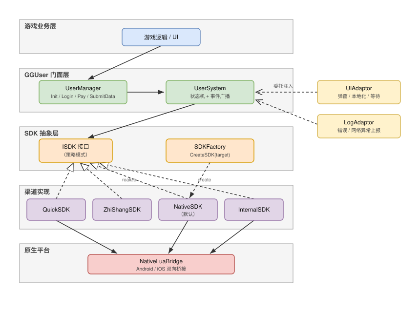
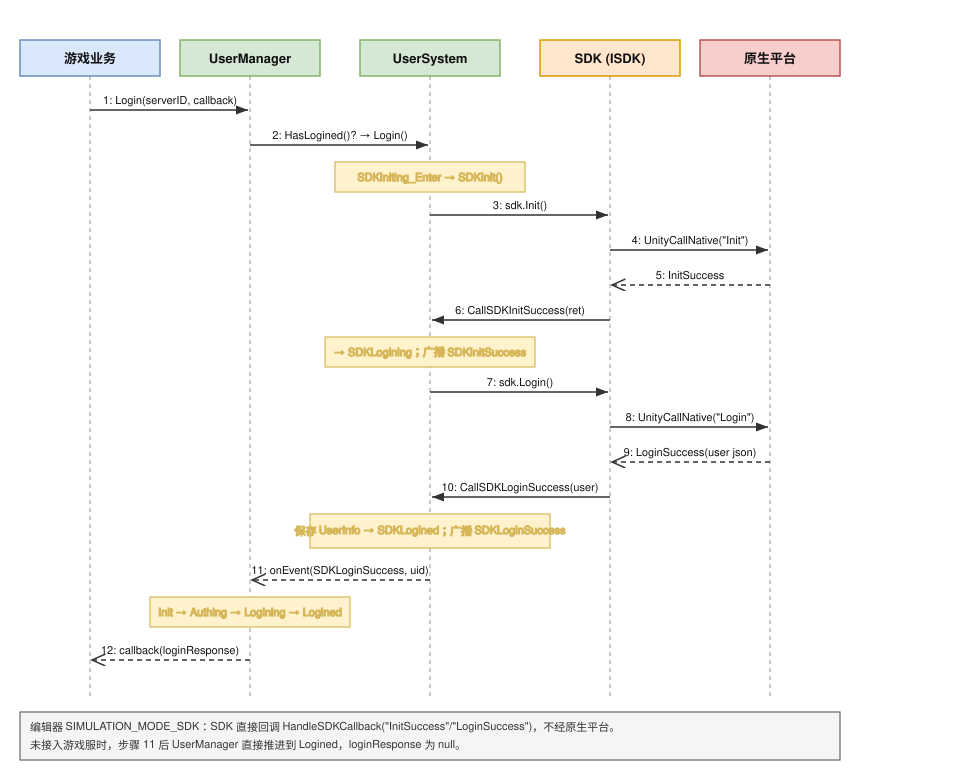
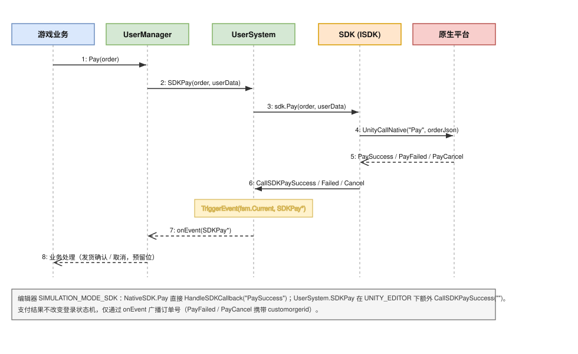
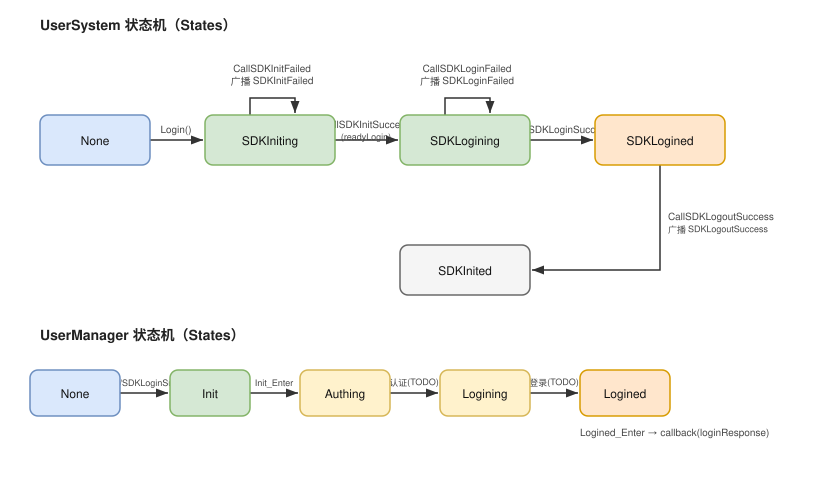

# GGUser 技术设计文档

> 面向游戏客户端的**用户 / 登录 / 支付 SDK 管理框架**。命名空间 `GGFramework.GGUser`，Unity 版本 **2021.3.4f1c1**。
>
> 本文依据仓库真实源码编写，配套 draw.io 图表位于 [`documents/diagrams/`](./diagrams/)，其中 `.drawio` 为可编辑源文件，`.svg` 为渲染视图。
>
> 快速上手见 [quickstart.md](./quickstart.md)，完整 API 见 [manual.md](./manual.md)。

---

## 目录

- [1. 设计目标](#1-设计目标)
- [2. 架构总览](#2-架构总览)
- [3. 分层职责](#3-分层职责)
- [4. 核心组件](#4-核心组件)
- [5. 登录流程](#5-登录流程)
- [6. 支付流程](#6-支付流程)
- [7. 状态机设计](#7-状态机设计)
- [8. 事件系统](#8-事件系统)
- [9. 平台桥接与编译宏](#9-平台桥接与编译宏)
- [10. 扩展新渠道](#10-扩展新渠道)
- [11. 设计模式与取舍](#11-设计模式与取舍)
- [12. 图表源文件与维护](#12-图表源文件与维护)

---

## 1. 设计目标

GGUser 要解决的核心问题是：**将「各渠道 SDK 的差异」与「游戏业务逻辑」彻底解耦**。为此确立以下目标：

1. **统一契约**：无论接入 QuickSDK、智尚、原生还是内部账号系统，业务层调用的 API 完全一致。
2. **可切换**：通过工厂 + 策略模式，一行代码即可切换目标渠道实现。
3. **可插拔**：UI 弹窗、本地化、日志上报等能力通过委托注入，框架不绑定任何具体 UI / 网络库。
4. **可离线调试**：编辑器下无需真机与渠道 SDK，即可跑通「初始化 → 登录 → 支付」全链路。
5. **流程可视**：以状态机管理登录各阶段，以事件回调对外广播生命周期节点。

---

## 2. 架构总览

框架自上而下分为五层，右侧为通过委托注入的适配器：



> 源文件：[`architecture.drawio`](./diagrams/architecture.drawio)

- **游戏业务层**只依赖门面 `UserManager`，不感知任何渠道细节。
- **门面层**由 `UserManager`（业务门面）与 `UserSystem`（核心用户系统）构成，二者均为单例。
- **SDK 抽象层**由 `ISDK` 接口与 `SDKFactory` 工厂组成，是解耦的关键。
- **渠道实现层**是各 SDK 的具体对接，统一把原生回调映射回 `UserSystem.CallSDK*`。
- **原生平台层** `NativeLuaBridge` 负责 Unity ↔ Android/iOS 的双向通信。
- **适配器**（`UIAdaptor` / `LogAdaptor`）由宿主注入具体实现，框架仅持有委托。

---

## 3. 分层职责

| 层 | 组件 | 职责 |
| ---- | ---- | ---- |
| 业务门面 | `UserManager` | 对外 API：`Init / Login / Pay / SubmitData / HasLogined`；维护游戏服登录状态机 |
| 核心系统 | `UserSystem` | 驱动 SDK 初始化 / 登录 / 支付；维护 SDK 状态机；`onEvent` 事件广播 |
| 抽象 | `ISDK` | 所有渠道实现的统一行为契约 |
| 工厂 | `SDKFactory` | 按 `SDKTarget` 创建渠道实例（简单工厂） |
| 渠道实现 | `NativeSDK` / `ZhiShangSDK` / `QuickSDKImpl` / `InternalSDK` | 对接具体渠道，回调统一转 `UserSystem.CallSDK*` |
| 平台桥接 | `NativeLuaBridge` / `PlatformInterfaces` / `AndroidInterfaces` | Unity ↔ 原生双向调用、设备信息封装 |
| 适配器 | `UIAdaptor` / `LogAdaptor` | 委托注入 UI 弹窗 / 本地化 / 日志上报 |
| 基础工具 | `Singleton<T>` / `CoroutineUtil` | 泛型单例基类、协程封装 |

---

## 4. 核心组件

### 4.1 UserSystem

- 单例（`Singleton<UserSystem>`，MonoBehaviour）。
- `Awake` 中初始化 `StateMachine<States>`，并通过 `SDKFactory.CreateSDK(SDKTarget.NativeSDK)` 创建默认 SDK。
- 对外暴露 `SDK` / `UserInfo` / `Channel` / `UIAdaptor` / `LogAdaptor` / `onEvent`。
- `SDKInit / SDKLogin / SDKPay / SDKLogout / SDKQuit` 在调用 `sdk.*` 前均做 `null` 保护，避免工厂未产出实例时空引用。
- `CallSDK*` 系列是所有渠道回调的统一入口：成功回调驱动状态机前进，失败 / 登出回调直接 `TriggerEvent` 广播。

### 4.2 UserManager

- 单例，业务层首选入口。
- `Init(channel)` 内部调用 `UserSystem.Init` 并订阅 `onEvent`，集中处理登录失败弹窗、支付结果等。
- `Login(serverID, callback)`：SDK 未登录时先登录 SDK；SDK 登录成功事件到达后推进自身状态机 `Init → Authing → Logining → Logined`，最终触发 `callback(loginResponse)`。
- **游戏服认证 / 登录（`Authing` / `Logining`）为预留位**：未接入游戏服时直接推进到下一状态，此时 `loginResponse` 为 `null`。接入时应在此处对接自己的网络层（建议配合 GGNetwork）。

### 4.3 ISDK / SDKFactory

```csharp
public interface ISDK
{
    void Init();
    void Login();
    void Logout();
    void Quit();
    void Pay(Order order, UserSystem.UserData userData = null);
    void SubmitData(string jsonData);
}
```

`SDKFactory.CreateSDK(SDKTarget)` 当前可直接创建 `NativeSDK`（默认）与 `ZhiShangSDK`；`QuickSDK` 需启用 `QUICK_SDK` 宏并放开对应分支；`InternalSDK` 未纳入 `SDKTarget` 枚举，需手动实例化。

### 4.4 渠道实现

所有实现都在构造时向 `NativeLuaBridge.onNativeCallUnity` 注册 `HandleSDKCallback`（QuickSDK 走 `QuickSDKListener` 回调），把渠道回调统一转为 `UserSystem.CallSDK*`，从而复用同一套状态机与事件广播。

### 4.5 NativeLuaBridge

- 单例，`Awake` 中 `DontDestroyOnLoad` 常驻。
- `UnityCallNative(method, json)`：Android 走 `AndroidJavaClass.CallStatic("CallInterface", ...)`（类名取自 `Global.AndroidInterfaceName`）；iOS 走 `[DllImport("__Internal")]` 声明的原生 C 函数。
- `NativeCallUnity(json)`：原生回调入口，解析 `{method, param}` 后触发 `onNativeCallUnity`。

### 4.6 适配器

`UIAdaptor`（`onDialog` / `onGetText` / `onWaiting`）与 `LogAdaptor`（`onPostError` / `onPostNetworkError`）均为委托容器，宿主注入后框架才具备弹窗 / 本地化 / 上报能力；未注入时以安全的默认行为降级（如 `ShowDialog` 直接回调 `true`）。

---

## 5. 登录流程



> 源文件：[`login-sequence.drawio`](./diagrams/login-sequence.drawio)

要点：

1. 业务调用 `UserManager.Login(serverID, callback)`。
2. 若 SDK 未登录，转 `UserSystem.Login()`，由状态机依次执行 `SDKIniting → SDKLogining → SDKLogined`。
3. 每步成功回调都会通过 `onEvent` 广播对应事件（`SDKInitSuccess` / `SDKLoginSuccess`）。
4. `UserManager` 收到 `SDKLoginSuccess` 后推进自身游戏服状态机，最终触发 `callback`。
5. 编辑器 `SIMULATION_MODE_SDK` 下，SDK 直接回调成功，不经原生平台。

---

## 6. 支付流程



> 源文件：[`pay-sequence.drawio`](./diagrams/pay-sequence.drawio)

要点：

1. 业务构造 `Order` 后调用 `UserManager.Pay(order)`。
2. `UserSystem.SDKPay` 调用 `sdk.Pay(order, userData)`；`NativeSDK` 会把 `userData` 合并进订单 JSON 再传原生。
3. 支付结果（成功 / 失败 / 取消）经 `CallSDKPay*` 转为 `onEvent` 广播，**不改变登录状态机**。
4. `PayFailed` / `PayCancel` 携带 `customorgerid`，便于对账。

---

## 7. 状态机设计

框架使用两套独立状态机：`UserSystem.States` 管理 SDK 生命周期，`UserManager.States` 管理游戏服登录生命周期。



> 源文件：[`state-machine.drawio`](./diagrams/state-machine.drawio)

关键约定：

- 状态切换通过 `StateMachine<States>.ChangeState`，切换到**相同状态不会重新进入**（`if (currentState == nextState) return;`）。因此失败回调不再依赖「重进当前状态」，而是直接 `TriggerEvent` 广播失败事件，重试与否交由业务层决定。
- 事件广播有两种路径：成功类事件通过 `SetEvent(state, e)` 登记、进入目标状态时由 `fsm.Changed` 广播；失败 / 登出类事件直接 `TriggerEvent(fsm.State, e, param)` 立即广播。

---

## 8. 事件系统

`UserSystem.onEvent` 是唯一对外广播出口，签名：

```csharp
public Action<States, Events, object> onEvent;
```

| 事件 | 触发入口 | param 典型内容 |
| ---- | ---- | ---- |
| `SDKInitSuccess` / `SDKInitFailed` | `CallSDKInitSuccess` / `CallSDKInitFailed` | 信息字符串 |
| `SDKLoginSuccess` | `CallSDKLoginSuccess` | 登录用户 `uid` |
| `SDKLoginFailed` | `CallSDKLoginFailed` | 失败信息字符串 |
| `SDKLogoutSuccess` | `CallSDKLogoutSuccess` | 信息字符串 |
| `SDKPaySuccess` / `SDKPayFailed` / `SDKPayCancel` | `CallSDKPay*` | 订单号等 |

> 订阅时机建议在 `UserManager.Init` **之前**，避免漏掉初始化后立即触发的事件；`MonoBehaviour` 中订阅记得在 `OnDestroy` 退订。

---

## 9. 平台桥接与编译宏

| 宏 | 含义 | 影响 |
| ---- | ---- | ---- |
| `UNITY_EDITOR` | 编辑器 | `UserSystem.SDKInit/Login/Pay` 直接模拟成功；`User` / `Order` 的 `isDev=true` |
| `SIMULATION_MODE_SDK` | 模拟 SDK | `NativeSDK` 各方法直接回调 `HandleSDKCallback`，不经原生 |
| `UNITY_ANDROID` / `UNITY_IOS` | 平台 | `NativeLuaBridge.UnityCallNative` 走 `AndroidJavaClass` / `DllImport` |
| `QUICK_SDK` | 启用 QuickSDK | `QuickSDKImpl` / `QuickSDKEventHandle` 内的渠道代码生效 |
| `LOGIN_FAILED_DEBUG` | 调试登录失败 | `UserSystem` 内模拟登录失败分支 |

真机相关代码统一被 `UNITY_ANDROID && !UNITY_EDITOR` 之类的组合宏包裹，保证编辑器下安全编译。

---

## 10. 扩展新渠道

1. 新建类实现 `ISDK`；构造函数中把渠道回调注册到统一入口（`NativeLuaBridge.onNativeCallUnity += HandleSDKCallback;`）。
2. 在 `HandleSDKCallback` 中把渠道事件映射到 `UserSystem.Instance.CallSDK*`。
3. 在 `SDKFactory.SDKTarget` 增加枚举值，并在 `CreateSDK` 对应 `case` 中 `new` 出实现。
4. 在 `UserSystem.Awake` 或按平台宏选择目标 `SDKTarget`。

> 铁律：**所有渠道回调最终都必须映射到 `UserSystem.CallSDK*` 系列**，框架才能统一驱动状态机与事件。

---

## 11. 设计模式与取舍

| 模式 | 落地 | 取舍说明 |
| ---- | ---- | ---- |
| 策略模式 | `ISDK` + 多实现 | 新增渠道零侵入业务层 |
| 简单工厂 | `SDKFactory.CreateSDK` | 渠道选择集中，代价是工厂需感知所有实现 |
| 单例 | `UserManager` / `UserSystem` / `NativeLuaBridge` | 全局唯一、便于回调；需注意场景切换与销毁时序 |
| 状态机 | `StateMachine<States>` | 流程清晰；同状态不重入的特性需在失败处理上规避 |
| 适配器 / 依赖倒置 | `UIAdaptor` / `LogAdaptor` 委托注入 | 不绑定 UI / 上报框架；未注入时降级 |
| 桥接 | `NativeLuaBridge` | Unity ↔ 原生双向通信统一收口 |

---

## 12. 图表源文件与维护

- 所有图表以 draw.io 格式维护，源文件为 `documents/diagrams/*.drawio`，可用 [draw.io](https://app.diagrams.net) / VS Code 的 Draw.io Integration 插件打开编辑。
- `*.svg` 为供 GitHub 与 Markdown 渲染的视图。修改 `.drawio` 后，请同步更新对应 `.svg`（可在 draw.io 中 `File → Export as → SVG` 导出覆盖）。

| 图表 | drawio 源 | SVG 视图 |
| ---- | ---- | ---- |
| 架构分层 | `diagrams/architecture.drawio` | `diagrams/architecture.svg` |
| 登录时序 | `diagrams/login-sequence.drawio` | `diagrams/login-sequence.svg` |
| 支付时序 | `diagrams/pay-sequence.drawio` | `diagrams/pay-sequence.svg` |
| 状态机 | `diagrams/state-machine.drawio` | `diagrams/state-machine.svg` |
